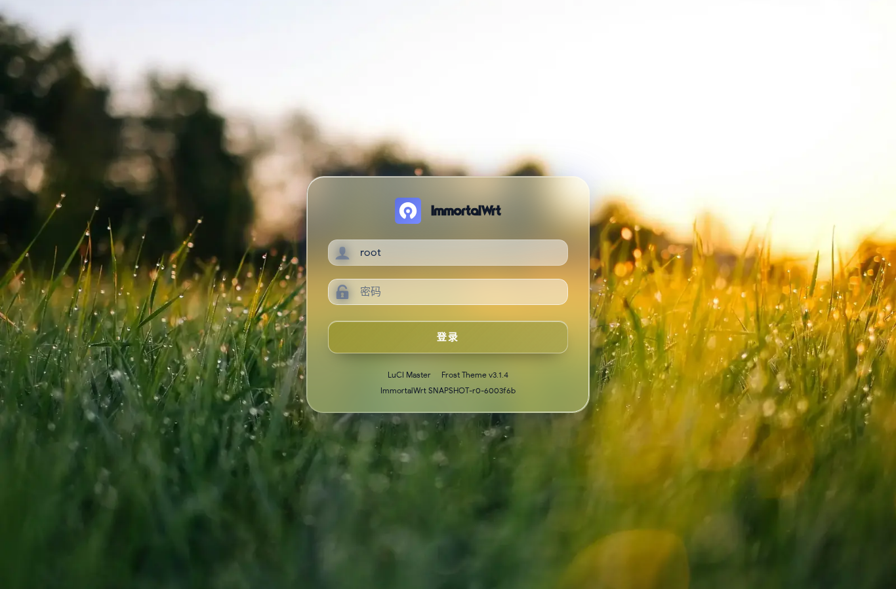
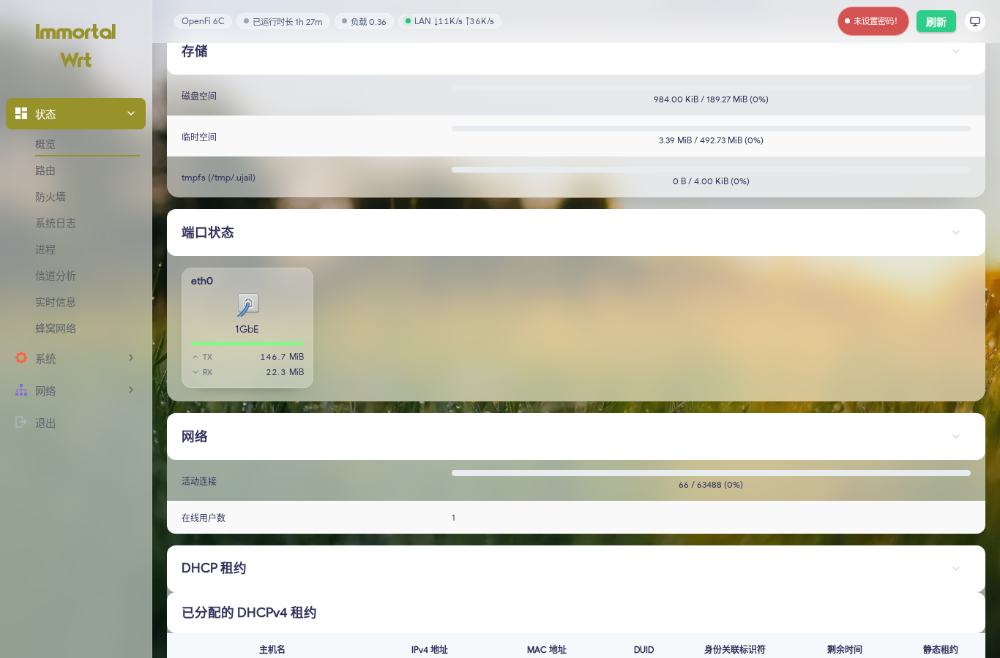
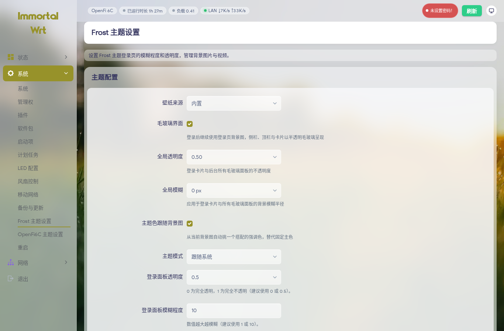
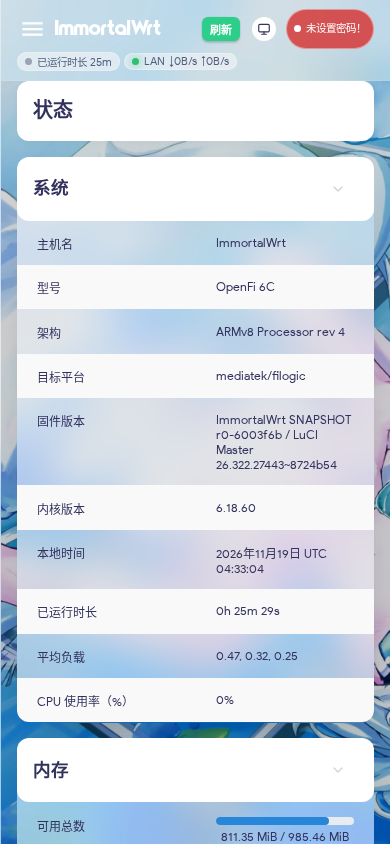

<div align="center">

# Frost · 霜

**A glassmorphism LuCI theme for OpenWrt / ImmortalWrt**
**一个玻璃拟态风格的 LuCI 主题**

[](LICENSE)
[]()



</div>

> Frost is a fork of [luci-theme-argon](https://github.com/jerrykuku/luci-theme-argon) with a
> focus on frosted-glass surfaces, a centered login card and a fast, app-like navigation.
> 本主题基于 [luci-theme-argon](https://github.com/jerrykuku/luci-theme-argon) 二次开发，
> 主打毛玻璃质感、居中登录卡片和类应用式的快速导航。

---

## 中文

### 截图

| 概览 | 主题设置 |
| --- | --- |
|  |  |

<p align="center"></p>

### 特性

- **居中玻璃登录卡片**：壁纸/字体就绪前显示缓冲动画，随后整页淡入，不会有壁纸"闪一下"
- **壁纸贯穿登录与后台**：登录页选中的壁纸写入 `sessionStorage`，进入后台直接复用，不再随机重选
- **主题色跟随壁纸**：Canvas 采样自动挑选强调色（sRGB→HSL 加权），结果缓存 7 天
- **全局毛玻璃**：一个"全局透明度 + 全局模糊"同时作用于登录卡片、侧栏、顶栏、卡片和表单
- **固定顶栏**：型号/运行时长/负载/实时流量 + 自动折叠的告警区，滚动不消失
- **异步菜单导航**：点击菜单只替换右侧容器，不整页刷新；页面模块按需加载
- **桌面端入场动画**：侧栏滑入、内容上浮（手机端与 `prefers-reduced-motion` 自动关闭）
- **移动端适配**：抽屉式菜单、可横向滚动的标签、紧凑卡片
- **玻璃瓦片端口卡片**：最小宽度为容器的 1/6，高度随内容自适应
- **完整中文/多语言**：随包提供 `po/` 翻译，配置项全部中文化
- **前端性能**：CSS 用 csso 预压缩（324 KB → 270 KB），字体 preload，主题资源带内容指纹 `?v=`

### 兼容性

- LuCI **24.10+ / SNAPSHOT**（ucode 模板运行时）
- 在 ImmortalWrt SNAPSHOT（MediaTek MT7981 / OpenFi 6C）上完成真机验证
- 依赖：`ucode-mod-math`、`jsonfilter`、`wget-any`（`LUCI_DEPENDS` 已声明）

### 安装

作为 feed 使用：

```sh
# feeds.conf 里加入（路径改成你的克隆位置）
src-link frost /path/to/luci-theme-frost

./scripts/feeds update frost
./scripts/feeds install -p frost luci-theme-frost
```

在 `make menuconfig` 中选中：

```
LuCI  --->  Themes  --->  <*> luci-theme-frost
LuCI  --->  Translations  --->  <*> luci-i18n-frost-config-zh-cn
```

编译并安装后启用：

```sh
uci set luci.main.mediaurlbase='/luci-static/frost'
uci set luci.themes.Frost='/luci-static/frost'
uci commit luci
/etc/init.d/uhttpd restart
```

主题设置位于 **系统 → Frost 配置**，配置文件为 `/etc/config/frost`。

### 构建说明

- `LUCI_MINIFY_CSS:=0` 必须保持：buildroot 自带的 csstidy 会破坏现代 CSS
  （例如把 `calc(var(--a) - var(--b))` 截断，导致第 293 条规则之后全部失效）。
- 可读样式源码在 `styles/cascade.source.css`，发布用的 `cascade.css` 由 csso 生成：

  ```sh
  npm install csso
  node scripts/minify-css.js
  ```

- `LUCI_MINIFY_UT:=0` 保持模板源码分发，兼容 stable 与 snapshot 的 ucode 字节码差异。

### 目录结构

```
ucode/template/themes/frost/   # 模板（head/header/login/sysauth/page_scripts…）
htdocs/luci-static/frost/      # 静态资源（CSS、图片、字体、图标）
htdocs/luci-static/resources/  # 主题 JS 模块与配置页 view
root/                          # rpcd/ACL/menu/uci-defaults/ucode 模块
po/                            # 翻译
styles/cascade.source.css      # 可读 CSS 源码
scripts/minify-css.js          # csso 压缩脚本
```

### 致谢与许可

- 基于 **luci-theme-argon**（© Jerrykuku，Apache-2.0）
- 本项目：**Apache-2.0 / MIT**，见 [LICENSE](LICENSE) 与 [NOTICE](NOTICE)
- 欢迎提交 issue / PR

---

## English

### Screenshots

| Overview | Theme settings |
| --- | --- |
|  |  |

<p align="center"></p>

### Features

- **Centered glass login card** with a boot spinner until the wallpaper/fonts are ready, then a smooth fade-in (no background "pop")
- **One wallpaper across login and admin**: the chosen image is stored in `sessionStorage` and reused instead of being re-picked
- **Accent color from the wallpaper**: weighted HSL sampling on a 32×32 canvas, cached for 7 days
- **Global glass scale**: a single transparency + blur setting drives the login card, sidebar, top bar, cards and forms
- **Sticky top bar** with model/uptime/load/live traffic and auto-collapsing warnings
- **Async menu navigation** that swaps only the right-hand container, with on-demand view modules
- **Desktop entrance animation**: sidebar slide-in and content fade-up (disabled on mobile and with `prefers-reduced-motion`)
- **Mobile layout**: drawer menu, scrollable tabs, compact cards
- **Glass port tiles**: at least 1/6 of the container width, content-driven height
- **Full i18n**: ships `po/` catalogs, Chinese UI complete
- **Performance**: csso-minified CSS (324 KB → 270 KB), preloaded fonts, content-fingerprinted `?v=` for theme assets

### Compatibility

- LuCI **24.10+ / SNAPSHOT** (ucode template runtime)
- Verified on ImmortalWrt SNAPSHOT, MediaTek MT7981 (OpenFi 6C)
- Depends on `ucode-mod-math`, `jsonfilter`, `wget-any` (declared in `LUCI_DEPENDS`)

### Install

Use it as a feed:

```sh
# add to feeds.conf (adjust the path)
src-link frost /path/to/luci-theme-frost

./scripts/feeds update frost
./scripts/feeds install -p frost luci-theme-frost
```

Enable in `make menuconfig`:

```
LuCI  --->  Themes  --->  <*> luci-theme-frost
LuCI  --->  Translations  --->  <*> luci-i18n-frost-config-zh-cn
```

After installing the image:

```sh
uci set luci.main.mediaurlbase='/luci-static/frost'
uci set luci.themes.Frost='/luci-static/frost'
uci commit luci
/etc/init.d/uhttpd restart
```

Settings live under **System → Frost Config** (`/etc/config/frost`).

### Build notes

- Keep `LUCI_MINIFY_CSS:=0`: buildroot's csstidy corrupts modern CSS
  (`calc(var(--a) - var(--b))` gets truncated and everything after rule 293 is dropped).
- The readable stylesheet is `styles/cascade.source.css`; the shipped `cascade.css`
  is generated with csso:

  ```sh
  npm install csso
  node scripts/minify-css.js
  ```

- Keep `LUCI_MINIFY_UT:=0` so template sources work on both stable and snapshot ucode runtimes.

### Credits & License

- Forked from **luci-theme-argon** (© Jerrykuku, Apache-2.0)
- **Apache-2.0 / MIT** — see [LICENSE](LICENSE) and [NOTICE](NOTICE)
- Issues and pull requests are welcome
